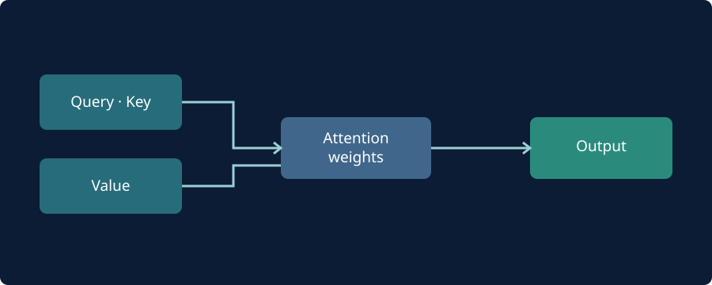

## কৃত্রিম বুদ্ধিমত্তা কী?

কৃত্রিম বুদ্ধিমত্তা (AI) এমন কম্পিউটার ব্যবস্থা নিয়ে কাজ করে, যা তথ্য থেকে ধরন শনাক্ত করতে, অনুমান করতে বা নির্দিষ্ট লক্ষ্য অনুযায়ী ফলাফল তৈরি করতে পারে।

## ট্রান্সফরমার কীভাবে কাজ করে?

ট্রান্সফরমার মডেলে **অ্যাটেনশন** ব্যবস্থার মাধ্যমে ইনপুটের বিভিন্ন অংশের মধ্যে সম্পর্ক নির্ধারণ করা যায়।

*চিত্র: অ্যাটেনশন ব্যবস্থার ধারণামূলক প্রবাহ।*

## স্কেলড ডট-প্রোডাক্ট অ্যাটেনশন

$$
\operatorname{Attention}(Q,K,V) =
\operatorname{softmax}\!\left(\frac{QK^T}{\sqrt{d_k}}\right)V
$$

এখানে $Q$, $K$, $V$ যথাক্রমে Query, Key ও Value ম্যাট্রিক্স; $d_k$ হলো Key ভেক্টরের মাত্রা।

## সীমাবদ্ধতা

AI মডেল ভুল তথ্য তৈরি করতে পারে, প্রশিক্ষণ ডেটার পক্ষপাত বহন করতে পারে এবং বাস্তব জগতের ঘটনার নিশ্চয়তাপূর্ণ ব্যাখ্যা দেয় না। তাই গুরুত্বপূর্ণ সিদ্ধান্তে যাচাই জরুরি।

## আরও পড়ুন

- [Attention Is All You Need (2017)](https://arxiv.org/abs/1706.03762)
