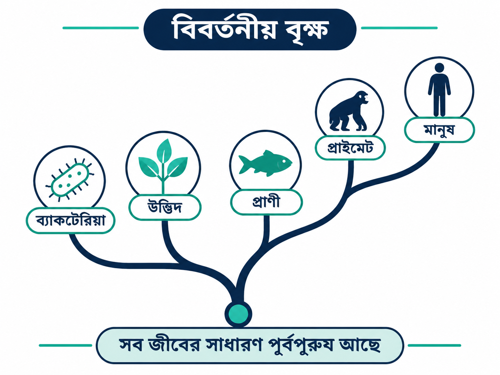
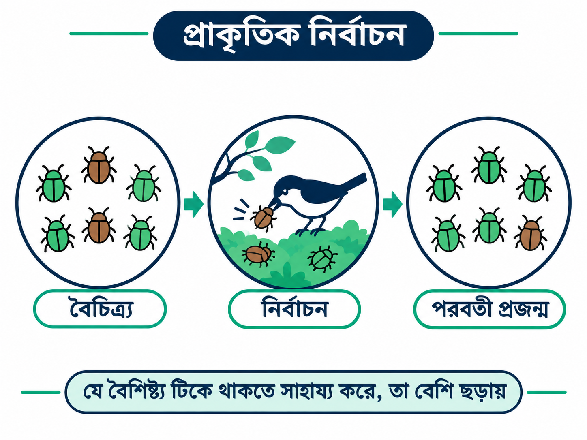
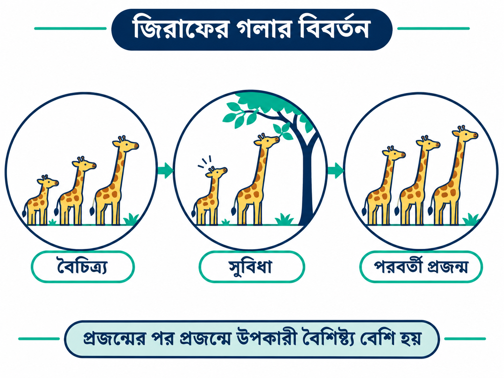
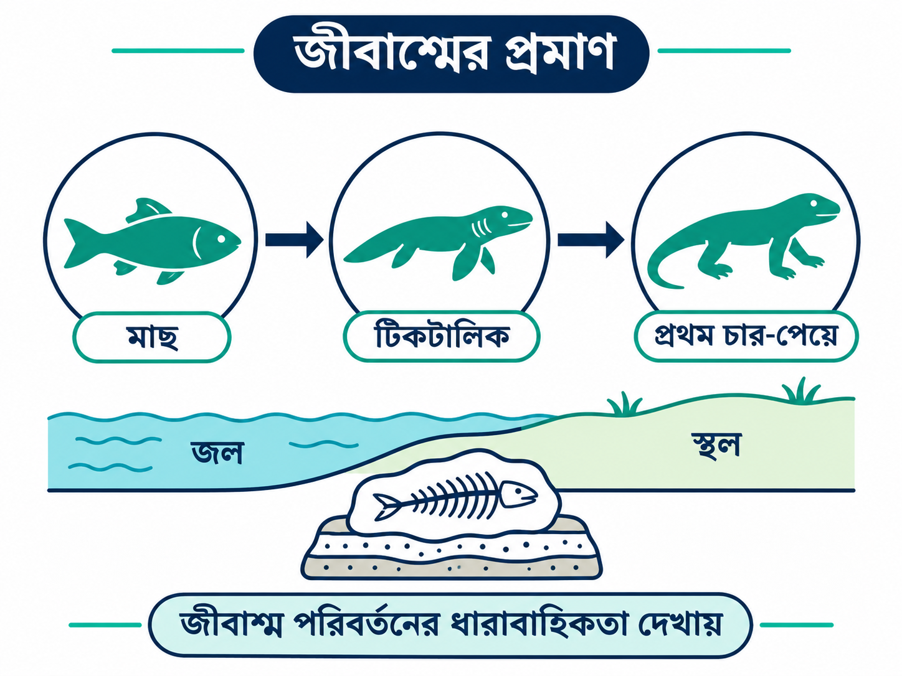
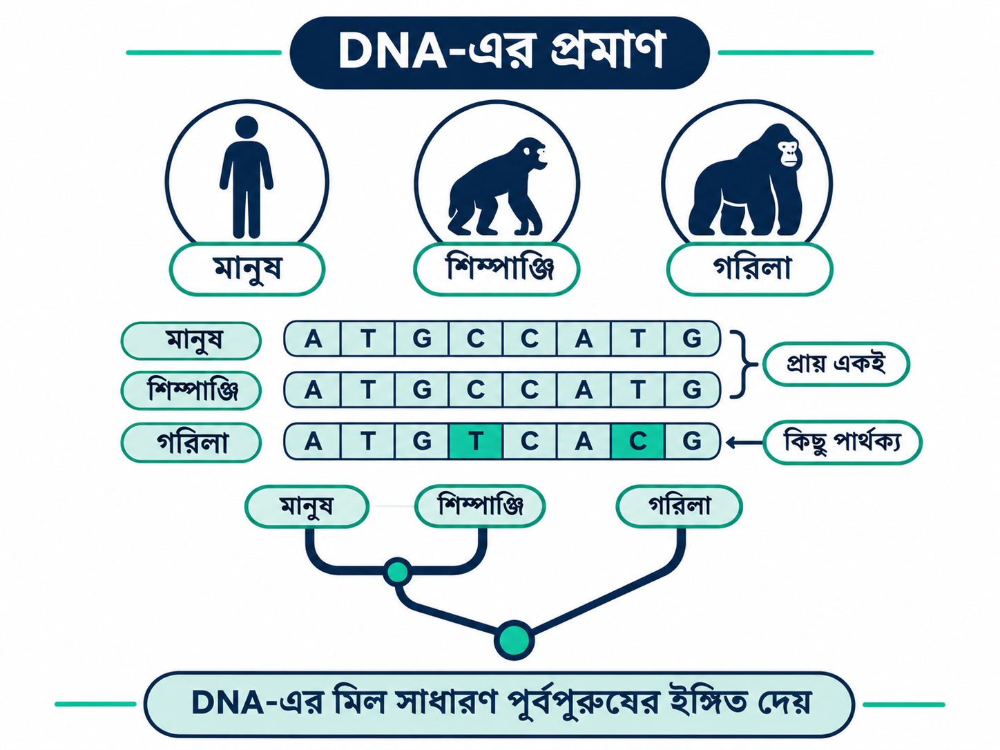

# বিবর্তন তত্ত্ব: পৃথিবীর জীবনের পরিবর্তনের অসাধারণ গল্প

## ১. ভূমিকা: আমরা সবাই কি দূরসম্পর্কের আত্মীয়?

একবার কল্পনা করুন, আপনার সামনে একটি বিশাল পারিবারিক বৃক্ষ রাখা হয়েছে। সেখানে শুধু আপনার বাবা-মা, দাদা-দাদি বা পূর্বপুরুষের নাম নেই। আছে একটি বিড়াল, একটি আমগাছ, একটি প্রজাপতি, এমনকি অণুবীক্ষণ যন্ত্র ছাড়া দেখা যায় না এমন ব্যাকটেরিয়াও!

শুনতে অদ্ভুত লাগছে, তাই না?

কিন্তু আধুনিক জীববিজ্ঞানের অন্যতম গুরুত্বপূর্ণ ধারণা হলো, **পৃথিবীর সব পরিচিত জীবের মধ্যে বিবর্তনীয় আত্মীয়তার সম্পর্ক রয়েছে।**

অর্থাৎ মানুষ, বিড়াল, পাখি কিংবা গাছ—সবাই জীবনের এক বিশাল ইতিহাসের অংশ।

এই সম্পর্ক বোঝার বিজ্ঞানই আমাদের নিয়ে যায় বিবর্তন তত্ত্বের কাছে।

*চিত্র ১: বিবর্তনীয় বৃক্ষ। এর শাখাগুলো দেখায় কীভাবে বিভিন্ন জীবগোষ্ঠী অতীতের সাধারণ পূর্বপুরুষ থেকে পৃথক বিবর্তনীয় পথে এগিয়েছে।*

## ২. বিবর্তন আসলে কী?

**বিবর্তন (Evolution)** হলো বংশপরম্পরায় কোনো জীবগোষ্ঠীর উত্তরাধিকারসূত্রে পাওয়া বৈশিষ্ট্যগুলোর পরিবর্তন।

সহজ ভাষায়, একটি প্রজন্ম থেকে পরবর্তী প্রজন্মে জীবের বংশগত বৈশিষ্ট্যের পরিবর্তন ঘটতে পারে। অনেক প্রজন্ম ধরে এই পরিবর্তন জমতে জমতে জীবগোষ্ঠীর চেহারা, আচরণ কিংবা পরিবেশের সঙ্গে খাপ খাইয়ে নেওয়ার ক্ষমতায় বড় পার্থক্য তৈরি হতে পারে।

ধরুন, একটি দ্বীপে এক ধরনের ছোট পাখি বাস করে।

কোনো পাখির ঠোঁট একটু মোটা, আবার কোনো পাখির ঠোঁট কিছুটা সরু।

দ্বীপে যদি শক্ত খোসাযুক্ত বীজ বেশি পাওয়া যায়, তাহলে মোটা ও শক্ত ঠোঁটের পাখিরা বীজ ভাঙতে সুবিধা পেতে পারে।

এই সুবিধা তাদের বেঁচে থাকা এবং সন্তান উৎপাদনে সাহায্য করলে, কয়েক প্রজন্ম পরে ওই ধরনের ঠোঁটের বৈশিষ্ট্য পাখিদের মধ্যে বেশি সাধারণ হয়ে উঠতে পারে।

এভাবেই একটি জীবগোষ্ঠী সময়ের সঙ্গে পরিবর্তিত হতে পারে।

তবে মনে রাখতে হবে, **একটি পাখি নিজের জীবদ্দশায় প্রয়োজন অনুযায়ী নতুন বংশগত ঠোঁট তৈরি করে না। পরিবর্তন ঘটে প্রজন্মের পর প্রজন্ম ধরে।**

## ৩. চার্লস ডারউইন ও একটি অসাধারণ ধারণা

১৮৫৯ সালে ব্রিটিশ প্রকৃতিবিদ চার্লস ডারউইন তাঁর বিখ্যাত বই *On the Origin of Species* প্রকাশ করেন।

এই বইয়ে তিনি ব্যাখ্যা করেন, কীভাবে **প্রাকৃতিক নির্বাচন (Natural Selection)** জীবের বিবর্তনের একটি গুরুত্বপূর্ণ কারণ হিসেবে কাজ করে।

ডারউইন লক্ষ্য করেছিলেন, একই প্রজাতির সব জীব পুরোপুরি একরকম নয়।

কেউ একটু দ্রুত দৌড়ায়, কেউ তুলনামূলক শক্তিশালী, আবার কেউ কোনো বিশেষ পরিবেশে খাদ্য সংগ্রহে বেশি দক্ষ।

এসব পার্থক্যের কিছু অংশ বংশগত।

কোনো বংশগত বৈশিষ্ট্য যদি নির্দিষ্ট পরিবেশে জীবের প্রজননগত সাফল্য বাড়ায়, তাহলে সেই বৈশিষ্ট্য ভবিষ্যৎ প্রজন্মে বেশি ছড়িয়ে পড়তে পারে।

এটাই প্রাকৃতিক নির্বাচনের মূল ধারণা।

### প্রাকৃতিক নির্বাচন কীভাবে কাজ করে?

প্রক্রিয়াটি চারটি ধাপে বোঝা যায়।

1. **Variation (বৈচিত্র্য):** একই জীবগোষ্ঠীর সদস্যদের মধ্যে বংশগত পার্থক্য থাকে।
2. **Inheritance (উত্তরাধিকার):** কিছু বৈশিষ্ট্য বাবা-মা থেকে সন্তানের মধ্যে যায়।
3. **Differential survival and reproduction (অসম বেঁচে থাকা ও প্রজনন সাফল্য):** নির্দিষ্ট পরিবেশে কিছু বৈশিষ্ট্যধারী জীব অন্যদের তুলনায় বেশি সফলভাবে বংশবিস্তার করে।
4. **Evolution over generations (প্রজন্ম ধরে পরিবর্তন):** উপকারী বৈশিষ্ট্যগুলো পরবর্তী প্রজন্মে তুলনামূলক বেশি সাধারণ হতে পারে।

*চিত্র ২: একটি জীবগোষ্ঠীতে বংশগত বৈচিত্র্য, পরিবেশগত নির্বাচন এবং কয়েক প্রজন্ম পর বৈশিষ্ট্যের অনুপাত পরিবর্তনের উদাহরণ।*

## ৪. জিরাফের গলা এত লম্বা কেন?

জিরাফের লম্বা গলা বিবর্তন বোঝানোর একটি পরিচিত উদাহরণ।

প্রশ্ন হলো, জিরাফ কি উঁচু গাছের পাতা খাওয়ার জন্য বারবার গলা টেনেছে, আর এভাবেই তার গলা লম্বা হয়েছে?

না। শুধু গলা টানার কারণে অর্জিত দৈর্ঘ্য সাধারণভাবে বংশগত হয়ে সন্তানের মধ্যে চলে যায় না।

বিবর্তনীয় ব্যাখ্যায় গুরুত্বপূর্ণ বিষয় হলো, জিরাফের পূর্বপুরুষদের মধ্যে গলার দৈর্ঘ্যসহ বিভিন্ন বংশগত বৈচিত্র্য ছিল।

কিছু পরিবেশে অপেক্ষাকৃত লম্বা গলা খাদ্য সংগ্রহে সুবিধা দিতে পারে। আবার গলার দৈর্ঘ্য নিয়ে যৌন নির্বাচনসহ অন্যান্য কারণও গুরুত্বপূর্ণ হতে পারে।

যেসব বংশগত বৈশিষ্ট্য প্রজননগত সাফল্য বাড়িয়েছে, সেগুলো দীর্ঘ সময় ধরে ছড়িয়ে পড়তে পেরেছে।

তবে জিরাফের গলার বিবর্তন একটি জটিল গবেষণার বিষয়; একে শুধু উঁচু পাতার জন্য গলা লম্বা হওয়ার গল্পে সীমাবদ্ধ রাখা ঠিক নয়।

*চিত্র ৩: গলার দৈর্ঘ্যে বংশগত বৈচিত্র্য এবং বহু প্রজন্ম ধরে প্রাকৃতিক নির্বাচনের সম্ভাব্য প্রভাবের সরলীকৃত ধারণাগত চিত্র। এটি জিরাফের প্রকৃত বিবর্তনীয় ইতিহাসের পূর্ণ পুনর্গঠন নয়।*

## ৫. বিবর্তন কি শুধু অতীতেই ঘটেছে?

একদম নয়!

বিবর্তন আজও ঘটছে। এমনকি কিছু ক্ষেত্রে বিজ্ঞানীরা বাস্তব সময়েই এর পরিবর্তন পর্যবেক্ষণ করতে পারেন।

### উদাহরণ: অ্যান্টিবায়োটিক প্রতিরোধী ব্যাকটেরিয়া

ধরুন, একদল ব্যাকটেরিয়ার মধ্যে কিছু ব্যাকটেরিয়ার এমন বংশগত বৈশিষ্ট্য রয়েছে, যার কারণে নির্দিষ্ট একটি অ্যান্টিবায়োটিক তাদের বিরুদ্ধে কম কার্যকর।

অ্যান্টিবায়োটিক প্রয়োগের ফলে অনেক সংবেদনশীল ব্যাকটেরিয়া মারা যেতে পারে। কিন্তু প্রতিরোধী ব্যাকটেরিয়াগুলো বেঁচে গিয়ে বংশবিস্তার করতে পারে।

ফলে পরবর্তী ব্যাকটেরিয়া জনগোষ্ঠীতে প্রতিরোধী ব্যাকটেরিয়ার অনুপাত বেড়ে যেতে পারে।

এটি প্রাকৃতিক নির্বাচনের বাস্তব উদাহরণ।

গুরুত্বপূর্ণ বিষয় হলো, অ্যান্টিবায়োটিক ব্যাকটেরিয়াকে সচেতনভাবে প্রতিরোধী হওয়ার শিক্ষা দেয় না। আগে থেকে থাকা প্রতিরোধক্ষমতা কিংবা নতুন জিনগত পরিবর্তন নির্বাচনের মাধ্যমে ছড়িয়ে পড়তে পারে। ব্যাকটেরিয়ার মধ্যে জিনের আদান-প্রদানও প্রতিরোধ ছড়াতে সাহায্য করে।

## ৬. বিবর্তনের বৈজ্ঞানিক প্রমাণ কী?

কোনো বৈজ্ঞানিক ধারণা শুধু সুন্দর গল্প হলেই গ্রহণযোগ্য হয় না। তাকে পর্যবেক্ষণ, পরীক্ষা এবং বিভিন্ন ধরনের প্রমাণের সঙ্গে সামঞ্জস্যপূর্ণ হতে হয়।

বিবর্তনের পক্ষে বিজ্ঞানীরা একাধিক স্বাধীন ক্ষেত্র থেকে প্রমাণ পেয়েছেন।

### প্রমাণ ১: জীবাশ্ম বা Fossils

পৃথিবীর বিভিন্ন ভূতাত্ত্বিক স্তরে প্রাচীন জীবের দেহাবশেষ ও চিহ্ন সংরক্ষিত রয়েছে। এগুলোকে জীবাশ্ম বলা হয়।

বিভিন্ন বয়সের শিলাস্তরে পাওয়া জীবাশ্ম তুলনা করলে দেখা যায়, পৃথিবীর জীবজগতের ইতিহাসে বহু পরিবর্তন ঘটেছে।

যেমন, *Tiktaalik* নামের প্রায় ৩৭৫ মিলিয়ন বছর পুরোনো একটি প্রাণীর জীবাশ্মে মাছের বৈশিষ্ট্যের পাশাপাশি এমন কিছু শারীরিক বৈশিষ্ট্য রয়েছে, যা স্থলচর মেরুদণ্ডী প্রাণীদের বিবর্তন বোঝার জন্য গুরুত্বপূর্ণ।

আবার প্রাচীন তিমির জীবাশ্ম থেকে বোঝা যায়, আধুনিক তিমির পূর্বপুরুষদের মধ্যে স্থলে চলাচলের উপযোগী বৈশিষ্ট্য ছিল।

*চিত্র ৪: বিভিন্ন ভূতাত্ত্বিক সময়ের জীবাশ্ম এবং মাছ থেকে প্রাথমিক চার-পা-বিশিষ্ট মেরুদণ্ডী প্রাণীর বিবর্তনীয় ইতিহাসে Tiktaalik-এর অবস্থানের ধারণাগত চিত্র।*

### প্রমাণ ২: DNA — জীবের ভেতরে লেখা ইতিহাস

DNA হলো জীবের বংশগত তথ্য বহনকারী অণু।

বিভিন্ন জীবের DNA তুলনা করে বিজ্ঞানীরা তাদের বিবর্তনীয় আত্মীয়তার সম্পর্ক সম্পর্কে গুরুত্বপূর্ণ তথ্য জানতে পারেন।

যেমন, মানুষ ও শিম্পাঞ্জির DNA-তে অত্যন্ত বেশি মিল পাওয়া যায়।

এটি প্রমাণ করে না যে মানুষ আজকের শিম্পাঞ্জি থেকে এসেছে।

বরং **মানুষ ও আধুনিক শিম্পাঞ্জির একটি সাধারণ পূর্বপুরুষ ছিল**, যার বংশধারা দীর্ঘ সময় আগে পৃথক পথে বিবর্তিত হয়েছে।

DNA-এর মিল, নির্দিষ্ট জিনের বিন্যাস এবং জিনগত পরিবর্তনের ধরন মিলিয়ে বিজ্ঞানীরা বিবর্তনীয় সম্পর্কের বিস্তারিত বৃক্ষ নির্মাণ করতে পারেন।

*চিত্র ৫: মানুষ, শিম্পাঞ্জি এবং আরও দূরসম্পর্কের প্রাণীদের মধ্যে নির্বাচিত DNA অনুক্রমের মিল ও পার্থক্য এবং একটি সরল বিবর্তনীয় বৃক্ষ।*

### প্রমাণ ৩: শরীরের গঠনের মিল

মানুষের হাত, বাদুড়ের ডানা এবং তিমির সামনের ফ্লিপারের কাজ আলাদা।

কিন্তু এগুলোর ভেতরের হাড়ের মৌলিক বিন্যাসে বিস্ময়কর মিল রয়েছে।

এ ধরনের গঠনকে Homologous Structures বলা হয়।

এসব মিল সাধারণ পূর্বপুরুষ থেকে উত্তরাধিকারসূত্রে পাওয়া শারীরিক কাঠামোর পরিবর্তনের সঙ্গে সামঞ্জস্যপূর্ণ।

### প্রমাণ ৪: ভৌগোলিক বিস্তার

পৃথিবীর বিভিন্ন দ্বীপে এমন কিছু জীব পাওয়া যায়, যাদের বৈশিষ্ট্য কাছাকাছি মূল ভূখণ্ডের জীবের সঙ্গে মেলে, কিন্তু দ্বীপের পরিবেশ অনুযায়ী আলাদা বৈশিষ্ট্যও রয়েছে।

গ্যালাপাগোস দ্বীপপুঞ্জের ফিঞ্চ পাখিরা এর একটি বিখ্যাত উদাহরণ।

দ্বীপগুলোর পরিবেশ, খাদ্য ও বিচ্ছিন্নতার ইতিহাস তাদের বিবর্তনীয় পার্থক্য বোঝাতে সাহায্য করে।

## ৭. মানুষ কি বানর থেকে এসেছে?

এই প্রশ্নটি প্রায়ই শোনা যায়।

বৈজ্ঞানিকভাবে সঠিক ব্যাখ্যা হলো, **মানুষ বর্তমানের কোনো বানর বা শিম্পাঞ্জি থেকে বিবর্তিত হয়নি।**

মানুষ ও অন্যান্য আধুনিক প্রাইমেটদের বিবর্তনীয় ইতিহাসে সাধারণ পূর্বপুরুষ রয়েছে।

একটি পরিবারের দুই চাচাতো ভাইয়ের যেমন সাধারণ দাদা থাকতে পারে, তেমনি দুটি আধুনিক প্রজাতিরও অতীতে একটি সাধারণ পূর্বপুরুষ থাকতে পারে।

তবে মানুষ ও শিম্পাঞ্জির সম্পর্ক বোঝার ক্ষেত্রে এটি শুধু একটি উপমা; তাদের প্রকৃত বিবর্তনীয় সম্পর্ক আরও দীর্ঘ এবং শাখাবহুল।

বিবর্তন কোনো সিঁড়ি নয়, যেখানে এক প্রাণী ধাপে ধাপে অন্য প্রাণীতে পরিণত হয়ে শেষ পর্যন্ত মানুষের জন্ম দেয়।

বরং এটি অসংখ্য শাখাবিশিষ্ট একটি বৃক্ষ।

## ৮. বিবর্তন সম্পর্কে তিনটি সাধারণ ভুল ধারণা

**ভুল ধারণা ১: বিবর্তন মানে সবসময় উন্নত হওয়া।**

বিবর্তনের কোনো পূর্বনির্ধারিত লক্ষ্য নেই। নির্দিষ্ট পরিবেশে একটি বৈশিষ্ট্য সুবিধাজনক হতে পারে, আবার পরিবেশ বদলালে সেটি অসুবিধাজনকও হতে পারে।

**ভুল ধারণা ২: জীব প্রয়োজন হলেই নিজেকে বিবর্তিত করে।**

কোনো প্রাণী ইচ্ছামতো নিজের DNA বদলে ভবিষ্যৎ প্রজন্মের জন্য প্রয়োজনীয় বৈশিষ্ট্য তৈরি করতে পারে না। জিনগত পরিবর্তন, প্রাকৃতিক নির্বাচন, জেনেটিক ড্রিফট ও জিনপ্রবাহসহ বিভিন্ন প্রক্রিয়া বিবর্তনে ভূমিকা রাখে।

**ভুল ধারণা ৩: বিবর্তন একটি তত্ত্ব, তাই এটি শুধু অনুমান।**

বিজ্ঞানে 'তত্ত্ব' বা Theory বলতে বিস্তৃত প্রমাণ দ্বারা সমর্থিত একটি ব্যাখ্যামূলক কাঠামো বোঝায়।

বিবর্তনের ঘটনা বহু ধরনের পর্যবেক্ষণে প্রতিষ্ঠিত। আর বিবর্তন তত্ত্ব ব্যাখ্যা করে কীভাবে এবং কোন প্রক্রিয়ায় এই পরিবর্তনগুলো ঘটে।

## ৯. তাহলে বিবর্তন জানা কেন গুরুত্বপূর্ণ?

বিবর্তন শুধু প্রাচীন প্রাণীর ইতিহাস জানার জন্য গুরুত্বপূর্ণ নয়।

চিকিৎসাবিজ্ঞানে অ্যান্টিবায়োটিক প্রতিরোধ বোঝা, ভাইরাসের পরিবর্তন অনুসরণ করা, কৃষিতে কীটনাশক প্রতিরোধের সমস্যা মোকাবিলা করা এবং বিপন্ন প্রজাতির সংরক্ষণ পরিকল্পনায় বিবর্তনীয় ধারণা গুরুত্বপূর্ণ ভূমিকা রাখে।

এমনকি আমাদের নিজেদের শরীর, জিন এবং রোগপ্রবণতার অনেক বিষয় বোঝার ক্ষেত্রেও বিবর্তনীয় ইতিহাস সহায়ক।

## ১০. উপসংহার: জীবনের গল্প এখনো শেষ হয়নি

পৃথিবীতে জীবনের ইতিহাস কয়েকশ কোটি বছরের।

এই দীর্ঘ সময়ে অসংখ্য জীবগোষ্ঠী পরিবর্তিত হয়েছে, অনেক প্রজাতি বিলুপ্ত হয়েছে এবং নতুন প্রজাতির উদ্ভব ঘটেছে।

বিবর্তন আমাদের শেখায়, জীবজগৎ স্থির নয়; এটি দীর্ঘ সময় ধরে পরিবর্তনশীল।

আর সবচেয়ে চমৎকার বিষয় হলো, সেই পরিবর্তন এখনো চলছে।

আজ যে জীবজগৎ আমরা দেখছি, সেটি একটি দীর্ঘ বিবর্তনীয় ইতিহাসের বর্তমান অধ্যায়।

**আমরাও সেই গল্পেরই অংশ।**

---

## তথ্যসূত্র ও আরও পড়ুন

1. Darwin, C. (1859). *On the Origin of Species*।
2. University of California, Berkeley — [Understanding Evolution](https://evolution.berkeley.edu/)
3. Smithsonian Institution — [Human Origins Program](https://humanorigins.si.edu/)
4. National Center for Biotechnology Information — [NCBI](https://www.ncbi.nlm.nih.gov/)
5. Futuyma, D. J., & Kirkpatrick, M. *Evolution* (জীববিজ্ঞানের পাঠ্যপুস্তক)।
