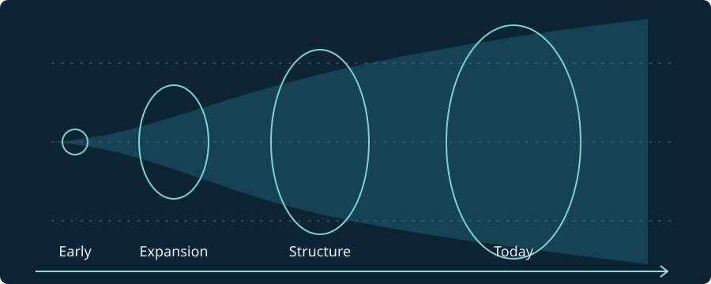

## মহাবিশ্বের শুরু বলতে কী বোঝায়?

বিগ ব্যাং মডেল অনুযায়ী মহাবিশ্ব একসময় অত্যন্ত উত্তপ্ত ও ঘন অবস্থায় ছিল। এরপর মহাবিশ্বের স্থান নিজেই প্রসারিত হয়েছে। এই মডেল **স্থান-কালের একেবারে প্রথম মুহূর্ত কীভাবে সৃষ্টি হলো**, সে প্রশ্নের পূর্ণ উত্তর দেয় না।

*চিত্র: মহাবিশ্বের প্রসারণের ধারণামূলক সময়রেখা (স্কেল অনুযায়ী নয়)।*

## মহাবিশ্ব কীভাবে প্রসারিত হয়?

দুটি দূরবর্তী গ্যালাক্সির মধ্যবর্তী স্থান বৃদ্ধি পেতে পারে। সাধারণভাবে, যথেষ্ট বড় মহাজাগতিক স্কেলে দূরত্ব বাড়ার হার বোঝাতে হাবলের সম্পর্ক ব্যবহার করা হয়:

$$
v = H_0 d
$$

এখানে $v$ হলো আপাত অপসরণবেগ, $d$ হলো দূরত্ব এবং $H_0$ হলো বর্তমান হাবল ধ্রুবক। এই সরল সম্পর্কটি ছোট রেডশিফটের ক্ষেত্রে সবচেয়ে সরাসরি প্রযোজ্য।

## ফ্রিডম্যান সমীকরণ

সাধারণ আপেক্ষিকতা এবং সমসত্ত্ব-সমদিকীয় মহাবিশ্বের মডেল থেকে একটি গুরুত্বপূর্ণ সমীকরণ পাওয়া যায়:

$$
H^2 = \left(\frac{\dot a}{a}\right)^2
= \frac{8\pi G}{3}\rho - \frac{k c^2}{a^2} + \frac{\Lambda c^2}{3}
$$

এখানে $a$ হলো স্কেল ফ্যাক্টর, $\rho$ হলো মোট ভর-শক্তির ঘনত্ব, $k$ স্থানিক বক্রতার পরামিতি এবং $\Lambda$ হলো মহাজাগতিক ধ্রুবক।

## প্রমাণ কী?

মহাবিশ্বের প্রসারণ, **কসমিক মাইক্রোওয়েভ ব্যাকগ্রাউন্ড (CMB)** এবং হালকা মৌলের প্রাচুর্য—এই পর্যবেক্ষণগুলো উত্তপ্ত বিগ ব্যাং মডেলকে সমর্থন করে।

## আরও পড়ুন

- [NASA — Big Bang](https://science.nasa.gov/universe/overview/)
- [ESA — Planck Mission](https://www.esa.int/Science_Exploration/Space_Science/Planck)
