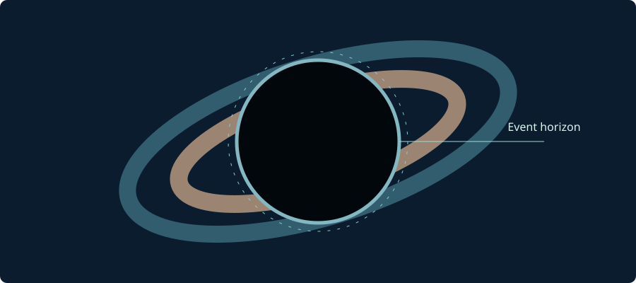

## কৃষ্ণগহ্বর কী?

কৃষ্ণগহ্বর হলো স্থান-কালের এমন অঞ্চল, যার **ইভেন্ট হরাইজন** অতিক্রম করার পর কোনো আলোক সংকেত বাইরের দূরবর্তী পর্যবেক্ষকের কাছে ফিরে যেতে পারে না।

*চিত্র: একটি অঘূর্ণায়মান কৃষ্ণগহ্বরের ধারণামূলক চিত্র (স্কেল অনুযায়ী নয়)।*

## শোয়ার্জশিল্ড ব্যাসার্ধ

অঘূর্ণায়মান ও বৈদ্যুতিক আধানবিহীন কৃষ্ণগহ্বরের ইভেন্ট হরাইজনের ব্যাসার্ধ:

$$
r_s = \frac{2GM}{c^2}
$$

এখানে $G$ মহাকর্ষীয় ধ্রুবক, $M$ ভর এবং $c$ আলোর বেগ।

## আলো কীভাবে আটকে যায়?

এটি কোনো সাধারণ বস্তু আলোর ওপর টান দেওয়ার বিষয় নয়। ইভেন্ট হরাইজনের ভেতর স্থান-কালের কারণগত গঠন এমন যে ভবিষ্যতের কোনো আলোকপথ বাইরের অসীম দূরত্বে পৌঁছাতে পারে না।

## আরও পড়ুন

- [NASA — Black Holes](https://science.nasa.gov/universe/black-holes/)
